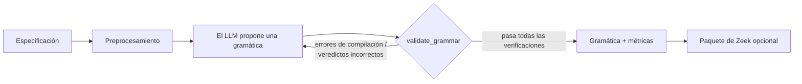

# SpicyGen — Generador de gramáticas

*[Read in English](README.md)*

SpicyGen usa modelos de lenguaje (LLM) para sintetizar parsers ejecutables de
protocolos de red a partir de especificaciones en lenguaje natural, como RFCs o
Blue Books de CCSDS. Los lenguajes destino soportados son:

| Destino | Extensión | Toolchain | Verificación en tiempo de ejecución |
|---|---|---|---|
| [Spicy](https://docs.zeek.org/projects/spicy/) | `.spicy` | `spicyc` → `.hlto` | `spicy-dump`, con comparación opcional de árboles de parseo |
| [3D / EverParse](https://project-everest.github.io/everparse/) | `.3d` | EverParse + GCC | wrapper en C generado |
| [Vest](https://github.com/secure-foundations/vest) | `.vest` | Vest + Verus | ejecutable en Rust generado |

Spicy soporta protocolos binarios y de texto; 3D y Vest, solo binarios.

El LLM no evalúa su propia salida. Propone una gramática y herramientas
deterministas la verifican: chequeos estáticos, el compilador del lenguaje
destino y un corpus de paquetes válidos e inválidos. Sus resultados vuelven al
modelo hasta que la gramática pasa todas las verificaciones o se agota el
presupuesto de intentos. Un parser en Spicy puede convertirse además en un
paquete de analizador para [Zeek](https://zeek.org/).



## Contenido

- [Requisitos](#requisitos)
- [Instalación](#instalación)
- [Inicio rápido](#inicio-rápido)
- [Herramientas de línea de comandos](#herramientas-de-línea-de-comandos)
- [Configuración](#configuración)
- [Corpus de paquetes](#corpus-de-paquetes)
- [Agregar modelos y protocolos](#agregar-modelos-y-protocolos)
- [Docker](#docker)
- [Tests](#tests)
- [Estructura del repositorio](#estructura-del-repositorio)
- [Más documentación](#más-documentación)

## Requisitos

- Python 3.12+ y [uv](https://docs.astral.sh/uv/).
- Credenciales de al menos un proveedor de LLM: Google Gemini, OpenAI,
  Anthropic u Ollama (local o en la nube).
- La toolchain de cada lenguaje destino que vayas a usar:
  - **Spicy**: `spicyc` y `spicy-dump` en el `PATH`.
  - **3D**: EverParse y un compilador de C (`gcc`). `EVERPARSE_SCRIPT_PATH`
    debe apuntar al script `everparse.sh`.
  - **Vest**: Vest y Verus. Definí `VEST_EXEC`, `VERUS_EXEC` y `VEST_LIB`.
  - **Paquetes de Zeek** (opcional): `zeek`, `zkg`, `spicyz`, `cmake`, `make`
    y `btest`.

La toolchain de un backend se carga solo cuando se elige ese lenguaje destino.

## Instalación

1. Instalá las dependencias:

   ```bash
   uv sync                 # dependencias de ejecución + grupo dev
   uv sync --extra testing # además instala pytest
   ```

   Esto también instala los scripts de consola `generate-grammar`,
   `preprocess-spec`, `run-pipeline` y `create-zeek-package`.

2. Copiá `.env.example` a `.env` y completá solo las variables que necesites:

   ```bash
   GEMINI_API_KEY=...
   OPENAI_API_KEY=...
   ANTHROPIC_API_KEY=...
   OLLAMA_API_KEY=...
   # Ollama local: http://127.0.0.1:11434/v1  ·  Ollama Cloud: https://ollama.com/v1
   OLLAMA_HOST_ENDPOINT=https://ollama.com/v1

   LOG_LEVEL=ERROR                                 # DEBUG, INFO, WARNING, ERROR
   EVERPARSE_SCRIPT_PATH=/opt/everparse/everparse.sh  # solo 3D
   VEST_EXEC=...  VERUS_EXEC=...  VEST_LIB=...      # solo Vest
   ```

   Ollama se usa a través de su API compatible con OpenAI, así que
   `OLLAMA_HOST_ENDPOINT` tiene que terminar en `/v1`. Los modelos con
   proveedor `openai-account` se sirven desde un proxy local compatible con
   OpenAI en `http://127.0.0.1:8000/v1` y no necesitan API key.

## Inicio rápido

Generar una gramática de Spicy para DNS y guardar las métricas:

```bash
uv run generate_grammar.py dns -m gemini-3.1-flash -t spicy \
    -o dns.spicy --metrics-file dns-metrics.json --debug-dir debug/dns
```

Si la generación falla, el archivo de salida contiene igual el **mejor
candidato** de la corrida. Revisá el campo `success` del archivo de métricas
antes de usar la gramática.

Correr el flujo completo en un workspace aislado (preprocesamiento, después
generación y después empaquetado para Zeek):

```bash
uv run pipeline.py run dns -m gemini-3.1-flash
```

## Herramientas de línea de comandos

Todas las herramientas aceptan `--help`. Donde se pide un modelo, es una clave
de `model_index.json`. Donde se pide un protocolo, es una clave de
`protocol_index.json`.

### `generate_grammar.py`: síntesis de gramáticas

```bash
python generate_grammar.py <protocolo> -m <modelo> [-t spicy|3d|vest] [opciones]
```

| Opción | Descripción |
|---|---|
| `-o, --output-file` | Dónde escribir la gramática. |
| `--metrics-file` | JSON con éxito, intentos, tokens, costo y tiempos. |
| `--debug-dir` | Guarda cada intento de refinamiento con la salida del compilador y del runtime. |
| `-c, --config` | YAML de configuración de generación (por defecto: `configs/default.yaml`). |
| `--spec-file` | Usa este texto de especificación en lugar del indexado, por ejemplo un resumen preprocesado. |
| `--no-spec` | Genera sin especificación; el modelo depende de su conocimiento previo y del feedback de los paquetes. |
| `-i, --instructions-file` | Reemplaza el manual del lenguaje de `prompts/` por un archivo propio. |

El LLM interactúa con el entorno a través de dos herramientas:

- **`validate_grammar`** compila el candidato. Si compila, corre el parser
  sobre los paquetes positivos y negativos del protocolo. El modelo recibe los
  diagnósticos del compilador o la lista de paquetes con veredicto incorrecto.
- **`retrieve_rfc_by_id`** descarga otro RFC cuando la especificación depende
  de él. Se puede desactivar en la configuración.

### `preprocess_spec.py`: preprocesamiento de la especificación

```bash
python preprocess_spec.py <protocolo> -m <modelo> \
    --info-output info.json --summary-output summary.txt \
    --negative-output negatives.jsonl --report-file report.json
```

El preprocesamiento tiene tres pasos independientes. Cada uno se puede omitir
con `--no-info`, `--no-summary` o `--no-negatives`:

1. **Información del protocolo**: extrae transportes, puertos y tipo de
   protocolo en JSON.
2. **Resumen**: el modelo elige las secciones relevantes y el programa las
   copia **textualmente** de la fuente. La especificación nunca se parafrasea.
3. **Paquetes negativos**: genera paquetes inválidos casi válidos en JSONL.
   Con `scripts/write_negative_packets.py` se convierten en fixtures `.bin`.
   El pipeline no hace este paso automáticamente.

### `pipeline.py`: orquestación con workspaces

El pipeline ejecuta las herramientas independientes como subprocesos. Cada
corrida tiene su propio workspace, `workspaces/<protocolo>/<modelo>/<timestamp>/`,
con un `manifest.json`, logs y un subdirectorio por paso. Si el
preprocesamiento generó `summary.txt`, el paso de generación lo usa
automáticamente como `--spec-file`.

```bash
python pipeline.py run dns -m gemini-3.1-flash               # todos los pasos
python pipeline.py run dns -m gemini-3.1-flash --only grammar
python pipeline.py run dns -m gemini-3.1-flash --resume      # retomar el último workspace
python pipeline.py run dns -m gemini-3.1-flash \
    --grammar-args "--config configs/no-spec.yaml" \
    --zeek-args "--skip-installation"
python pipeline.py init dns -m gemini-3.1-flash               # solo crear la estructura
python pipeline.py status --protocol dns                      # listar workspaces
```

Por defecto el pipeline se detiene en el primer paso que falla; con
`--keep-going` sigue igual. El paso `zeek-package` funciona solo con Spicy.
Con `-t 3d` o `-t vest`, elegí los pasos vos con `--only`. Más detalles en
[docs/pipeline.md](docs/pipeline.md).

### `run_eval.py`: matrices de evaluación

`run_eval.py` reemplaza a `benchmark.sh`. Expande un YAML en el producto
cartesiano de protocolos × modelos × configuraciones × lenguajes destino ×
muestras, corre cada combinación y agrega los resultados.

```bash
python run_eval.py evals/example.yaml --dry-run          # mostrar la matriz
python run_eval.py evals/example.yaml --parallelism 4 --debug
python run_eval.py evals/example.yaml --resume --eval-dir outputs/<sesion>
python run_eval.py evals/example.yaml --retry-failed --eval-dir outputs/<sesion>
```

```yaml
name: "binary-protocols-comparison"
defaults:
  models: ["gemini-3.5-flash", "qwen3-coder"]
  configs: ["configs/default.yaml"]
  target_languages: ["spicy"]
  samples: 3            # habilita estadísticas pass@k
protocols:
  dns: {}
  dhcp: { spec_file: "specs/dhcp-summary.txt" }
  tftp: { no_spec: true }
```

Cada sesión escribe `eval_state.json`, `report.jsonl` y `summary.md` (tablas
por modelo y por protocolo, pass@k y corridas fallidas) en
`outputs/<timestamp>_<nombre>/`. Una corrida termina en uno de tres estados:
completada con una gramática válida, completada sin una, o fallida (timeout,
error o métricas faltantes). Ver [docs/evaluation.md](docs/evaluation.md) y las
configuraciones en [`evals/`](evals/).

### `create_zeek_package.py`: integración con Zeek

```bash
python create_zeek_package.py dns.spicy --metadata info.json \
    -m gemini-3.1-flash --output-dir zeek-packages \
    [--traces-dir data/dns/traces] [--skip-installation]
```

El script crea la estructura del paquete con `zkg` y adapta el parser para
Zeek. Después le pide al LLM los archivos `.evt`, Spicy del lado de Zeek y
`.zeek`, y los refina con los diagnósticos de `spicyz`. Por último genera
firmas de detección y tests. Ver [docs/integration.md](docs/integration.md).

### Scripts auxiliares (`scripts/`)

| Script | Propósito |
|---|---|
| `run_parser_trace.py` | Corre un parser `.spicy` o `.3d` sobre un directorio de paquetes `.bin` e informa las tasas de aceptación y rechazo. |
| `extract_layer.py` | Extrae una capa de protocolo de capturas `.pcap`/`.pcapng` a archivos `.bin` (usa Scapy). |
| `wireshark_oracle.py` | Usa los disectores de TShark como oráculo independiente de validez de paquetes. |
| `write_negative_packets.py` | Convierte los negativos JSONL del preprocesamiento en fixtures `.bin`. |
| `generate_grammar_one_shot.py` | Baseline: una sola consulta al LLM, sin feedback de herramientas. |
| `generate_grammar_codex_harness.py` | Baseline: generación a través del harness de Codex CLI. |

## Configuración

Los parámetros de generación se guardan en archivos YAML dentro de `configs/`.
El valor por defecto es `configs/default.yaml`:

```yaml
llm:
  temperature: 0.0
  reasoning_effort: "medium"
  # también se aceptan max_tokens, top_p, timeout, seed, cache_seed
agent:
  max_retries: 15                  # presupuesto de intentos
  enable_preprocessing: true       # chequeos estáticos propios del lenguaje antes de compilar
  enable_rfc_retrieval_tool: true  # habilita retrieve_rfc_by_id
  enable_negative_packets: true    # exige también rechazar los paquetes inválidos
  show_packet_representation: false  # muestra al modelo los bytes de los paquetes que fallan
  show_parsing_tree: false           # compara con los archivos .tree y muestra la diferencia (Spicy)
```

Los manuales de lenguaje que recibe el modelo están en `prompts/<lenguaje>/`
y se eligen según el tipo de protocolo (`BINARY.md`, `TEXT.md`).

## Corpus de paquetes

La validación en tiempo de ejecución usa los fixtures de `data/raw/<protocolo>/`:

```
data/raw/dns/
├── positive/          # deben aceptarse
│   ├── a-query.bin
│   └── a-query.tree   # opcional: árbol de parseo esperado en Spicy
└── negative/          # deben rechazarse
    ├── dns_header_reserved_nonzero.bin
    └── dns_header_reserved_nonzero.bin.info   # opcional: por qué es inválido
```

El corpus cubre 41 de los 43 protocolos indexados. Cuando existe un archivo
`.tree` y `show_parsing_tree` está activado, una diferencia estructural cuenta
como falla. Así se detectan gramáticas que lo aceptan todo (por ejemplo
`bytes &eod`) pero no extraen ninguna estructura.

## Agregar modelos y protocolos

### Modelos (`model_index.json`)

```json
"gemini-3.1-flash": {
  "name": "gemini-3.1-flash-lite",
  "provider": "google",
  "context-window": "1000000",
  "cutoff-date": "01-25",
  "price": [0.00025, 0.0015]
}
```

- `name`: el identificador del modelo que se envía a la API del proveedor.
- `provider`: uno de `google`, `openai`, `anthropic`, `ollama`,
  `openai-account`.
- `context-window`: tamaño máximo de contexto.
- `price` (entrada/salida cada 1K tokens), `cached-price`, `cutoff-date`:
  opcionales, para el reporte de costos.

Los modelos de OpenAI que usan razonamiento pasan por el cliente stateless
de Responses (`src/responses_client.py`). Así se evita la duplicación del
historial de AG2 y el caché de prompts sigue siendo efectivo.

### Protocolos (`protocol_index.json`)

```json
"dns": {
  "full_name": "Domain Name System",
  "type": "binary",
  "spec_type": "rfc",
  "rfc_id": "1035"
}
```

- `type`: `binary` o `text`; determina el manual de lenguaje.
- `spec_type`: `rfc`, `bluebook` u `other`.
- `rfc_id`: número de RFC; se descarga y limpia automáticamente.
- `local_spec_file`: especificación local para usar en lugar de un RFC, por
  ejemplo `specs/spp-bluebook.txt`.
- `parser_arguments`: contrato opcional de argumentos externos (ver abajo).

Después agregá paquetes en `data/raw/<protocolo>/positive` y `.../negative`.
`scripts/extract_layer.py` y `scripts/wireshark_oracle.py` ayudan a
construirlos.

#### Argumentos externos del parser

Algunos protocolos se parsean con configuración que no está en los bytes del
paquete (por ejemplo, la longitud de trama en CCSDS). Declará los argumentos
en la entrada del protocolo:

```json
"parser_arguments": [
  {"name": "frame_length", "type": "uint64", "description": "Configured frame length."},
  {"name": "has_fecf", "type": "bool", "description": "Whether an FECF is present."}
]
```

Un `type` se puede redefinir por lenguaje destino:

```json
{"name": "frame_length", "type": {"spicy": "uint64", "3d": "uint32"}}
```

Los valores de cada paquete se guardan junto a sus bytes en
`<paquete>.bin.args.json`:

```json
{"frame_length": 16, "has_fecf": true}
```

El modelo recibe los nombres de los argumentos y sus tipos resueltos como
contrato. En tiempo de ejecución se validan contra ese contrato tanto la firma
del punto de entrada generado como las claves del sidecar. Los valores se
asocian por nombre, se reordenan según la firma y se compilan en un wrapper;
los wrappers se cachean para cada conjunto distinto de argumentos. Los sidecars de
Spicy aceptan `bool`, enteros con y sin signo de 8/16/32/64 bits, `string`,
`real` y `double`.

## Docker

Cada imagen incluye la toolchain de un backend:

```bash
docker build -f Dockerfile.spicy -t grammar-generator:spicy .
docker build -f Dockerfile.3d    -t grammar-generator:3d .

docker run --rm --env-file .env grammar-generator:spicy \
    generate-grammar dns -m gemini-3.1-flash -t spicy -o /tmp/dns.spicy
docker run --rm --env-file .env grammar-generator:3d \
    run-pipeline run dns -m gemini-3.1-flash -t 3d --only grammar
```

Podés fijar la versión de Spicy con `--build-arg SPICY_VERSION=v1.16.0` o
`--build-arg SPICY_DEB_URL=<url>`. El `.deb` por defecto está compilado para
`amd64`. En otras arquitecturas, pasá una URL compatible o construí con
`--platform linux/amd64`.

## Tests

```bash
uv run pytest
```

La mayoría de los tests reemplazan los proveedores de LLM y los compiladores
en puntos acotados, así que no necesitan credenciales. Los tests que usan un
backend real necesitan su toolchain instalada.

## Estructura del repositorio

```
├── generate_grammar.py      # CLI de síntesis de gramáticas
├── preprocess_spec.py       # CLI de preprocesamiento de especificaciones
├── pipeline.py              # orquestador de workspaces
├── run_eval.py              # ejecutor de matrices de evaluación
├── create_zeek_package.py   # generador de paquetes de Zeek
├── src/
│   ├── agent.py             # loop de refinamiento con AutoGen
│   ├── prompts.py           # armado del system prompt
│   ├── target_language.py   # fábrica abstracta de lenguajes destino
│   ├── providers.py         # modelo → configuración de AutoGen
│   ├── responses_client.py  # cliente stateless de OpenAI Responses
│   ├── protocol.py          # modelo del catálogo de protocolos
│   ├── workspace.py         # manifiestos de workspaces
│   └── tools/               # adaptadores de compilador/runtime: spicy/, _3d/, vest/
├── prompts/                 # manuales de lenguaje (spicy, 3D, vest, zeek)
├── configs/                 # configuraciones de generación (y configs/evals/ para ablaciones)
├── evals/                   # definiciones de matrices de evaluación
├── data/raw/                # corpus de paquetes
├── specs/                   # especificaciones locales (Blue Books, MQTT)
├── scripts/                 # scripts auxiliares y baselines
├── outputs/stable/          # gramáticas generadas seleccionadas
├── analysis/                # análisis de evaluaciones
├── docs/                    # documentos de diseño y evaluación
└── tests/
```

## Más documentación

La documentación detallada está en inglés:

- [docs/architecture.md](docs/architecture.md): el loop del agente, sus
  herramientas y los backends de lenguajes destino.
- [docs/pipeline.md](docs/pipeline.md): workspaces y formato del manifiesto.
- [docs/evaluation.md](docs/evaluation.md): el ejecutor de evaluaciones.
- [docs/integration.md](docs/integration.md): generación de paquetes de Zeek.

> **Sobre la corrección.** Una corrida exitosa significa que la gramática pasa
> el conjunto de validaciones configurado: el compilador, los fixtures y,
> opcionalmente, la comparación de árboles de parseo. No prueba que cumpla con
> toda la especificación. El código generado se compila y ejecuta sin
> sandboxing, así que conviene correr los experimentos no confiables dentro de
> un contenedor.
