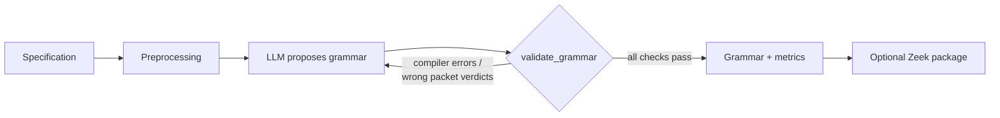

# SpicyGen — Grammar Generator

*[Leer en español](README.es.md)*

SpicyGen uses large language models (LLMs) to synthesize executable
network-protocol parsers from natural-language specifications such as RFCs and
CCSDS Blue Books. The supported target languages are:

| Target | Extension | Toolchain | Runtime check |
|---|---|---|---|
| [Spicy](https://docs.zeek.org/projects/spicy/) | `.spicy` | `spicyc` → `.hlto` | `spicy-dump`, with optional parse-tree comparison |
| [3D / EverParse](https://project-everest.github.io/everparse/) | `.3d` | EverParse + GCC | generated C wrapper |
| [Vest](https://github.com/secure-foundations/vest) | `.vest` | Vest + Verus | generated Rust executable |

Spicy handles both binary and text protocols; 3D and Vest handle binary ones
only.

The LLM does not judge its own output. It proposes a grammar, and deterministic
tools check it: static checks, the target compiler, and a corpus of valid and
invalid packets. Their feedback goes back to the model until the grammar passes
every check or the attempt budget runs out. A Spicy parser can then be turned
into a [Zeek](https://zeek.org/) analyzer package.



## Contents

- [Requirements](#requirements)
- [Setup](#setup)
- [Quick start](#quick-start)
- [Command-line tools](#command-line-tools)
- [Configuration](#configuration)
- [Packet corpus](#packet-corpus)
- [Adding models and protocols](#adding-models-and-protocols)
- [Docker](#docker)
- [Testing](#testing)
- [Repository layout](#repository-layout)
- [Further documentation](#further-documentation)

## Requirements

- Python 3.12+ and [uv](https://docs.astral.sh/uv/).
- Credentials for at least one LLM provider: Google Gemini, OpenAI, Anthropic,
  or Ollama (local or cloud).
- The toolchain for each target language you plan to use:
  - **Spicy**: `spicyc` and `spicy-dump` on `PATH`.
  - **3D**: EverParse and a C compiler (`gcc`). Point `EVERPARSE_SCRIPT_PATH`
    at the `everparse.sh` script.
  - **Vest**: Vest and Verus. Set `VEST_EXEC`, `VERUS_EXEC` and `VEST_LIB`.
  - **Zeek packages** (optional): `zeek`, `zkg`, `spicyz`, `cmake`, `make`
    and `btest`.

A backend's toolchain is loaded only when that target language is selected.

## Setup

1. Install dependencies:

   ```bash
   uv sync                 # runtime dependencies + dev group
   uv sync --extra testing # also install pytest
   ```

   This also installs the console scripts `generate-grammar`,
   `preprocess-spec`, `run-pipeline` and `create-zeek-package`.

2. Copy `.env.example` to `.env` and fill in only the variables you need:

   ```bash
   GEMINI_API_KEY=...
   OPENAI_API_KEY=...
   ANTHROPIC_API_KEY=...
   OLLAMA_API_KEY=...
   # Local Ollama: http://127.0.0.1:11434/v1  ·  Ollama Cloud: https://ollama.com/v1
   OLLAMA_HOST_ENDPOINT=https://ollama.com/v1

   LOG_LEVEL=ERROR                                 # DEBUG, INFO, WARNING, ERROR
   EVERPARSE_SCRIPT_PATH=/opt/everparse/everparse.sh  # 3D only
   VEST_EXEC=...  VERUS_EXEC=...  VEST_LIB=...      # Vest only
   ```

   Ollama is accessed through its OpenAI-compatible API, so
   `OLLAMA_HOST_ENDPOINT` must end in `/v1`. Models with the `openai-account`
   provider are served by a local OpenAI-compatible proxy at
   `http://127.0.0.1:8000/v1` and need no API key.

## Quick start

Generate a Spicy grammar for DNS and record metrics:

```bash
uv run generate_grammar.py dns -m gemini-3.1-flash -t spicy \
    -o dns.spicy --metrics-file dns-metrics.json --debug-dir debug/dns
```

When generation fails, the output file still holds the **best candidate** seen
during the run. Check `success` in the metrics file before you rely on the
grammar.

Run the full workflow in an isolated workspace (preprocessing, then
generation, then Zeek packaging):

```bash
uv run pipeline.py run dns -m gemini-3.1-flash
```

## Command-line tools

All tools accept `--help`. Wherever a model is required, it is a key from
`model_index.json`. Wherever a protocol is required, it is a key from
`protocol_index.json`.

### `generate_grammar.py`: grammar synthesis

```bash
python generate_grammar.py <protocol> -m <model> [-t spicy|3d|vest] [options]
```

| Option | Description |
|---|---|
| `-o, --output-file` | Where to write the grammar. |
| `--metrics-file` | JSON with success, attempts, tokens, cost and timing. |
| `--debug-dir` | Saves every refinement attempt with its compiler and runtime output. |
| `-c, --config` | Generation config YAML (default: `configs/default.yaml`). |
| `--spec-file` | Use this specification text instead of the indexed one, e.g. a preprocessed summary. |
| `--no-spec` | Generate without a specification; the model relies on prior knowledge and packet feedback. |
| `-i, --instructions-file` | Replace the language manual from `prompts/` with your own file. |

The LLM interacts with the environment through two tools:

- **`validate_grammar`** compiles the candidate. If compilation succeeds, it
  runs the parser on the protocol's positive and negative packets. The
  compiler's diagnostics, or the packets that got the wrong verdict, are
  returned to the model.
- **`retrieve_rfc_by_id`** fetches another RFC when the specification depends
  on one. It can be turned off in the config.

### `preprocess_spec.py`: specification preprocessing

```bash
python preprocess_spec.py <protocol> -m <model> \
    --info-output info.json --summary-output summary.txt \
    --negative-output negatives.jsonl --report-file report.json
```

Preprocessing performs three independent steps, each of which can be skipped
with `--no-info`, `--no-summary` or `--no-negatives`:

1. **Protocol info**: extracts transports, ports and protocol type as JSON.
2. **Summary**: the model picks the relevant sections, and the program copies
   them **verbatim** from the source. The spec is never paraphrased.
3. **Negative packets**: generates near-valid invalid packets as JSONL. Use
   `scripts/write_negative_packets.py` to turn them into `.bin` fixtures. The
   pipeline does not do this automatically.

### `pipeline.py`: workspace orchestration

The pipeline runs the standalone tools as subprocesses. Each run gets its own
workspace, `workspaces/<protocol>/<model>/<timestamp>/`, holding a
`manifest.json`, logs, and one subdirectory per step. If preprocessing
produced `summary.txt`, the grammar step uses it as `--spec-file`
automatically.

```bash
python pipeline.py run dns -m gemini-3.1-flash               # all steps
python pipeline.py run dns -m gemini-3.1-flash --only grammar
python pipeline.py run dns -m gemini-3.1-flash --resume      # continue latest workspace
python pipeline.py run dns -m gemini-3.1-flash \
    --grammar-args "--config configs/no-spec.yaml" \
    --zeek-args "--skip-installation"
python pipeline.py init dns -m gemini-3.1-flash               # scaffold only
python pipeline.py status --protocol dns                      # list workspaces
```

By default the pipeline aborts at the first failed step; `--keep-going`
continues anyway. The `zeek-package` step works only with Spicy. With `-t 3d`
or `-t vest`, choose the steps yourself with `--only`. See
[docs/pipeline.md](docs/pipeline.md) for details.

### `run_eval.py`: evaluation matrices

`run_eval.py` replaces `benchmark.sh`. It expands a YAML file into the
cross-product of protocols × models × configs × target languages × samples,
runs every combination, and aggregates the results.

```bash
python run_eval.py evals/example.yaml --dry-run          # print the matrix
python run_eval.py evals/example.yaml --parallelism 4 --debug
python run_eval.py evals/example.yaml --resume --eval-dir outputs/<session>
python run_eval.py evals/example.yaml --retry-failed --eval-dir outputs/<session>
```

```yaml
name: "binary-protocols-comparison"
defaults:
  models: ["gemini-3.5-flash", "qwen3-coder"]
  configs: ["configs/default.yaml"]
  target_languages: ["spicy"]
  samples: 3            # enables pass@k statistics
protocols:
  dns: {}
  dhcp: { spec_file: "specs/dhcp-summary.txt" }
  tftp: { no_spec: true }
```

Each session writes `eval_state.json`, `report.jsonl` and `summary.md`
(per-model and per-protocol tables, pass@k, and failed runs) under
`outputs/<timestamp>_<name>/`. A run ends in one of three states: completed
with a valid grammar, completed without one, or failed (timeout, crash, or
missing metrics). See [docs/evaluation.md](docs/evaluation.md) and the
configurations in [`evals/`](evals/).

### `create_zeek_package.py`: Zeek integration

```bash
python create_zeek_package.py dns.spicy --metadata info.json \
    -m gemini-3.1-flash --output-dir zeek-packages \
    [--traces-dir data/dns/traces] [--skip-installation]
```

The script scaffolds a package with `zkg` and adapts the parser for Zeek. It
then asks the LLM for the `.evt`, Zeek-side Spicy and `.zeek` files and
refines them using `spicyz` diagnostics. Finally it generates detection
signatures and tests. See [docs/integration.md](docs/integration.md).

### Utility scripts (`scripts/`)

| Script | Purpose |
|---|---|
| `run_parser_trace.py` | Runs a `.spicy` or `.3d` parser over a directory of `.bin` packets and reports accept/reject rates. |
| `extract_layer.py` | Extracts one protocol layer from `.pcap`/`.pcapng` captures into `.bin` files (uses Scapy). |
| `wireshark_oracle.py` | Uses TShark dissectors as an independent oracle for packet validity. |
| `write_negative_packets.py` | Converts preprocessing JSONL negatives into `.bin` fixtures. |
| `generate_grammar_one_shot.py` | Baseline: a single LLM request with no tool feedback. |
| `generate_grammar_codex_harness.py` | Baseline: generation through the Codex CLI harness. |

## Configuration

Generation parameters are stored in YAML files under `configs/`. The default
is `configs/default.yaml`:

```yaml
llm:
  temperature: 0.0
  reasoning_effort: "medium"
  # max_tokens, top_p, timeout, seed, cache_seed are also accepted
agent:
  max_retries: 15                  # attempt budget
  enable_preprocessing: true       # target-specific static checks before compiling
  enable_rfc_retrieval_tool: true  # expose retrieve_rfc_by_id
  enable_negative_packets: true    # also require invalid packets to be rejected
  show_packet_representation: false  # show failing packet bytes to the model
  show_parsing_tree: false           # compare against .tree files and show the diff (Spicy)
```

The language manuals sent to the model are in `prompts/<language>/` and
are selected by protocol type (`BINARY.md`, `TEXT.md`).

## Packet corpus

Runtime validation uses fixtures under `data/raw/<protocol>/`:

```
data/raw/dns/
├── positive/          # must be accepted
│   ├── a-query.bin
│   └── a-query.tree   # optional: expected Spicy parse tree
└── negative/          # must be rejected
    ├── dns_header_reserved_nonzero.bin
    └── dns_header_reserved_nonzero.bin.info   # optional: why it is invalid
```

The corpus covers 41 of the 43 indexed protocols. When a `.tree` file exists
and `show_parsing_tree` is enabled, a structural mismatch counts as a failure.
This catches grammars that accept everything (e.g. `bytes &eod`) but extract
no structure.

## Adding models and protocols

### Models (`model_index.json`)

```json
"gemini-3.1-flash": {
  "name": "gemini-3.1-flash-lite",
  "provider": "google",
  "context-window": "1000000",
  "cutoff-date": "01-25",
  "price": [0.00025, 0.0015]
}
```

- `name`: the model identifier sent to the provider API.
- `provider`: one of `google`, `openai`, `anthropic`, `ollama`,
  `openai-account`.
- `context-window`: the maximum context size.
- `price` (input/output per 1K tokens), `cached-price`, `cutoff-date`:
  optional, used for cost reporting.

OpenAI models that use reasoning go through the stateless Responses client
(`src/responses_client.py`). It avoids AG2's history duplication and keeps
prompt caching effective.

### Protocols (`protocol_index.json`)

```json
"dns": {
  "full_name": "Domain Name System",
  "type": "binary",
  "spec_type": "rfc",
  "rfc_id": "1035"
}
```

- `type`: `binary` or `text`; selects the language manual.
- `spec_type`: `rfc`, `bluebook` or `other`.
- `rfc_id`: the RFC number, fetched and cleaned automatically.
- `local_spec_file`: a local specification to use instead of an RFC, e.g.
  `specs/spp-bluebook.txt`.
- `parser_arguments`: an optional external argument contract (see below).

Then add packets under `data/raw/<protocol>/positive` and `.../negative`.
`scripts/extract_layer.py` and `scripts/wireshark_oracle.py` can help build
them.

#### External parser arguments

Some protocols are parsed using configuration that is not in the packet bytes
(e.g. CCSDS frame lengths). Declare the arguments in the protocol entry:

```json
"parser_arguments": [
  {"name": "frame_length", "type": "uint64", "description": "Configured frame length."},
  {"name": "has_fecf", "type": "bool", "description": "Whether an FECF is present."}
]
```

A `type` can be overridden per target language:

```json
{"name": "frame_length", "type": {"spicy": "uint64", "3d": "uint32"}}
```

Store each packet's values next to its bytes in `<packet>.bin.args.json`:

```json
{"frame_length": 16, "has_fecf": true}
```

The model is given the argument names and their resolved types as a
contract. At runtime, the generated entry-point signature and the sidecar
keys are both checked against it. Values are bound by name, reordered to match
the signature, and compiled into a wrapper; wrappers are cached per distinct
argument set. Spicy sidecars accept `bool`, signed and unsigned 8/16/32/64-bit
integers, `string`, `real` and `double`.

## Docker

Each image bundles one backend toolchain:

```bash
docker build -f Dockerfile.spicy -t grammar-generator:spicy .
docker build -f Dockerfile.3d    -t grammar-generator:3d .

docker run --rm --env-file .env grammar-generator:spicy \
    generate-grammar dns -m gemini-3.1-flash -t spicy -o /tmp/dns.spicy
docker run --rm --env-file .env grammar-generator:3d \
    run-pipeline run dns -m gemini-3.1-flash -t 3d --only grammar
```

You can pin a Spicy version with `--build-arg SPICY_VERSION=v1.16.0` or
`--build-arg SPICY_DEB_URL=<url>`. The default `.deb` is built for
`amd64`. On other architectures, pass a compatible URL or build with
`--platform linux/amd64`.

## Testing

```bash
uv run pytest
```

Most tests stub out LLM providers and compilers at narrow boundaries, so they
need no credentials. Tests that exercise a real backend need its toolchain
installed.

## Repository layout

```
├── generate_grammar.py      # grammar synthesis CLI
├── preprocess_spec.py       # specification preprocessing CLI
├── pipeline.py              # workspace orchestrator
├── run_eval.py              # evaluation matrix runner
├── create_zeek_package.py   # Zeek package generator
├── src/
│   ├── agent.py             # AutoGen refinement loop
│   ├── prompts.py           # system-prompt assembly
│   ├── target_language.py   # target-language abstract factory
│   ├── providers.py         # model → AutoGen config
│   ├── responses_client.py  # stateless OpenAI Responses client
│   ├── protocol.py          # protocol catalogue model
│   ├── workspace.py         # workspace manifests
│   └── tools/               # compiler/runtime adapters: spicy/, _3d/, vest/
├── prompts/                 # language manuals (spicy, 3D, vest, zeek)
├── configs/                 # generation configs (and configs/evals/ for ablations)
├── evals/                   # evaluation matrix definitions
├── data/raw/                # packet corpus
├── specs/                   # local specifications (Blue Books, MQTT)
├── scripts/                 # utility and baseline scripts
├── outputs/stable/          # curated generated grammars
├── analysis/                # evaluation analyses
├── docs/                    # design and evaluation documents
└── tests/
```

## Further documentation

- [docs/architecture.md](docs/architecture.md): the agent loop, its tools and
  the target-language backends.
- [docs/pipeline.md](docs/pipeline.md): workspaces and manifest format.
- [docs/evaluation.md](docs/evaluation.md): the evaluation runner.
- [docs/integration.md](docs/integration.md): Zeek package generation.

> **A note on correctness.** A successful run means the grammar passes the
> configured validation suite: the compiler, the fixtures, and optionally
> parse-tree comparisons. It does not prove conformance with the entire
> specification. Generated code is compiled and executed without sandboxing,
> so run untrusted experiments in a container.
