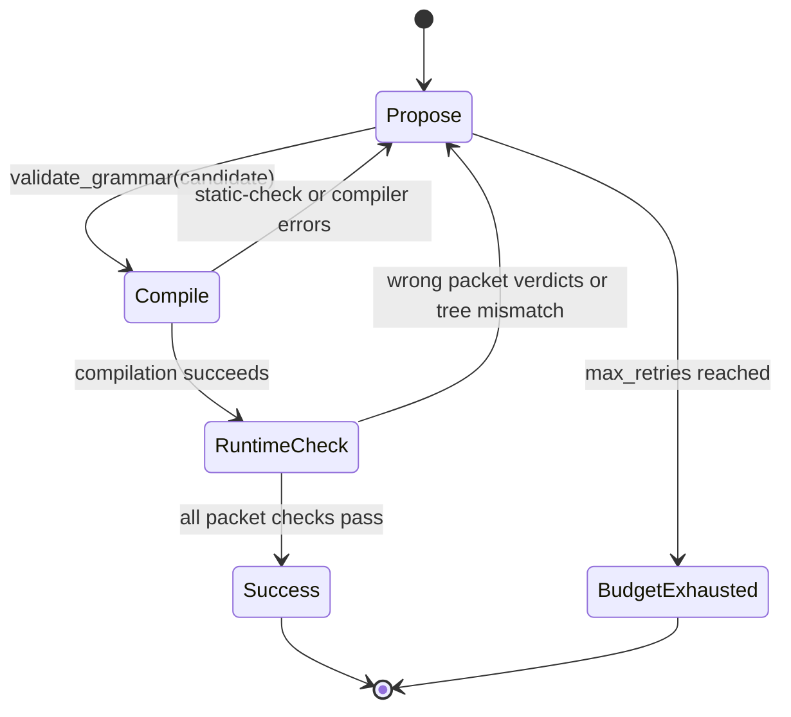

# Architecture

SpicyGen generates a protocol grammar by running an LLM inside a refinement
loop. The model proposes a grammar, deterministic tools check it, and their
feedback goes back to the model. This document describes that loop, the tools
the model can call, and how target-language backends plug in.

## Components

| Component | File | Role |
|---|---|---|
| Entry point | `generate_grammar.py` | Resolves the protocol, specification, model and config; writes the grammar and metrics. |
| Refinement loop | `src/agent.py` | Runs the AutoGen conversation and tracks attempts and the best candidate. |
| Validation | `src/validation.py` | Compiles one candidate, runs the packet checks, and formats feedback. |
| Prompts | `src/prompts.py`, `prompts/` | Assembles the system prompt from fixed text and per-language manuals. |
| Target languages | `src/target_language.py` | Abstract factory that creates each backend's compiler, runtime and response cleaner. |
| Backends | `src/tools/{spicy,_3d,vest}/` | Static checks, compilers, runtime adapters and wrappers. |
| Providers | `src/providers.py`, `src/responses_client.py` | Turns a `model_index.json` entry into an AutoGen config. |
| Protocols | `src/protocol.py` | Loads `protocol_index.json` entries, including external parser arguments. |

## The agent loop

`run_refinement_loop()` starts a conversation between two AutoGen agents:

- **The developer** (`AssistantAgent`) is the LLM. It is named after the
  target language (`SpicyDeveloper`, `3DDeveloper`, `VestDeveloper`).
- **`CompilerProxy`** (`UserProxyAgent`) runs tools for the developer. It never
  asks a human for input. If the model replies without calling a tool, the
  proxy tells it to call `validate_grammar`.

The first user message is the specification text (or a no-spec prompt)
followed by "Please output the grammar and verify it with the given tools."



### Tools

1. **`validate_grammar(code)`**: one call checks one candidate:
   1. The backend's response cleaner strips Markdown fences and other
      wrapping.
   2. If `enable_preprocessing` is on, backend-specific static checks run. For
      Spicy these flag reserved field names and bitfields without
      `&bit-order`.
   3. The target compiler runs. On failure, its diagnostics are returned to
      the model.
   4. The runtime adapter parses every fixture in
      `data/raw/<protocol>/positive/` and, if `enable_negative_packets` is on,
      every fixture in `data/raw/<protocol>/negative/`. Positive packets must
      be accepted and negative packets rejected. If `show_parsing_tree` is on,
      the Spicy parse tree must also match the expected `.tree` file. The model
      receives the list of failing packets, and the packet bytes too if
      `show_packet_representation` is on.
2. **`retrieve_rfc_by_id(rfc_id)`**: downloads and cleans another RFC. It is
   registered only when `enable_rfc_retrieval_tool` is on.

### Scoring and termination

Each candidate that reaches the runtime check gets a score: one point per
packet with the correct verdict. The highest-scoring candidate is kept; on a
tie, the earlier one wins. The run ends when one of these happens:

- every packet check passes (`termination_reason: success`);
- `max_retries` validation calls have been used (`max_retries`);
- the model says `TERMINATE` on its own (`agent_terminated`);
- an exception stops the conversation (`runtime_exception`).

The generator writes the best-scoring candidate. If no candidate compiled, it
writes the last one submitted. In both cases the file may not be a valid
grammar, so check `success` in the metrics.

If a protocol has no packets, the model is told to stop after the grammar
compiles, but the run is still recorded as `success: false`.

### Metrics

`--metrics-file` writes one JSON object per run:

```json
{
  "model": "gpt-5.4", "protocol": "dns", "target_language": "spicy",
  "success": true, "spec_source": "index",
  "positive_packets": 16, "negative_packets": 10, "max_total_retries": 15,
  "best_iteration": 5, "termination_reason": "success",
  "first_successful_compile_iteration": 2,
  "iterations": [
    {"compiled": true, "positive_accepted": 16, "negative_rejected": 5, "changed_from_previous": true}
  ],
  "retrieved_rfcs": ["1034"],
  "time_elapsed_s": 292.71,
  "usage": {"total_usage": {"total_cost": 0.32, "prompt_tokens": 60830, "completion_tokens": 11423}}
}
```

`spec_source` is `index`, `no specification`, or the path passed to
`--spec-file`.

With `--debug-dir`, each attempt is saved as follows:

```
debug/
├── runtime.log
├── refinement/Grammar_<n>.<ext>     # candidate submitted at attempt n
├── errors/<n>-compilation.log       # compiler output
├── errors/<n>-runtime.log           # packet-check output
└── build/step_<n>/                  # build artifacts
```

## System prompt

`build_refinement_system_message()` joins four parts:

1. `BASE_GENERATION_PROMPT`: the model's role and goal.
2. The language manual. The default comes from
   `TargetLanguage.instructions_path_for(protocol_type)`; `--instructions-file`
   replaces it, e.g. with `prompts/spicy/NO_DOCS.md` for the no-docs ablation.
3. The external parser argument contract, if the protocol declares
   `parser_arguments`.
4. `AGENT_LOOP_INSTRUCTIONS_TEMPLATE`: how to use the tools and when to stop.
   It mentions parse-tree feedback and RFC retrieval only when they are
   available.

The preprocessing prompts (spec summary, protocol info, negative packets) are
also in `src/prompts.py`.

## Target languages

`TargetLanguage` is an abstract factory. Each subclass creates its own
compiler, runtime adapter and response cleaner, and chooses its language
manual. Backend modules are imported inside the factory methods, so a backend's
toolchain and environment variables are only required when it is selected.

| Name | Manuals | Compiler | Runtime | Required environment |
|---|---|---|---|---|
| `spicy` | `prompts/spicy/BINARY.md`, `TEXT.md` | `spicyc` → `.hlto` | `spicy-dump`, with parse-tree comparison | `spicyc`, `spicy-dump` on `PATH` |
| `3d` | `prompts/3D/BINARY.md` | EverParse | generated C wrapper built with GCC | `EVERPARSE_SCRIPT_PATH` |
| `vest` | `prompts/vest/BINARY.md` | Vest | generated Rust executable built with Verus | `VEST_EXEC`, `VERUS_EXEC`, `VEST_LIB` |

Only Spicy supports `text` protocols; 3D and Vest accept `binary` ones only.

All runtimes implement `RuntimeAdapter` (`src/tools/runtime.py`). It covers
preparing a parser once, running it on each packet, optionally preparing
per-packet wrappers (used for external parser arguments), caching, and
summarizing results. The shared runtime code finds the fixtures, compares
expected and actual verdicts, and removes temporary artifacts.

To add a backend, you need:

- a language manual for each protocol type it supports;
- a compiler function that returns `CompileResult`;
- a `RuntimeAdapter`;
- a response cleaner (optional);
- a `TargetLanguage` subclass registered in `SUPPORTED_TARGET_LANGUAGES`.

## Providers

`get_model_config()` reads the `model_index.json` entry and the `llm:` section
of the config, and `ModelConfig.as_autogen_config()` builds the AutoGen config:

| Provider | Credentials | Notes |
|---|---|---|
| `google` | `GEMINI_API_KEY` | |
| `openai` | `OPENAI_API_KEY` | With `reasoning_effort` set, uses `StatelessResponsesClient`. |
| `anthropic` | `ANTHROPIC_API_KEY` | |
| `ollama` | `OLLAMA_API_KEY`, `OLLAMA_HOST_ENDPOINT` | OpenAI-compatible endpoint ending in `/v1`. |
| `openai-account` | none | Local OpenAI-compatible proxy at `http://127.0.0.1:8000/v1`. |

`StatelessResponsesClient` exists because AG2's own Responses clients chain
`previous_response_id` and also resend the whole history, so the context grows
by the full conversation on every turn. This client sends the history with
`store=False`, carries reasoning forward as encrypted content, and keeps
request prefixes stable so OpenAI's prompt cache applies.

## Other generation strategies

The scripts below generate grammars without the agent loop. They are used as
baselines:

- `scripts/generate_grammar_one_shot.py`: one LLM request, then a single
  validation pass whose result is never sent back to the model.
- `scripts/generate_grammar_codex_harness.py`: generation through the Codex
  CLI harness, validated the same way.
