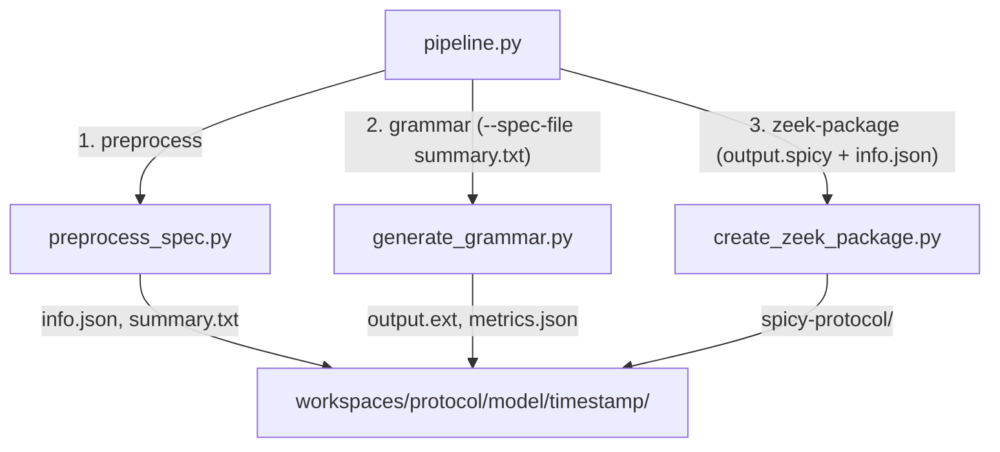

# Pipeline and Workspaces

`pipeline.py` chains the three standalone tools inside an isolated
**workspace**:

1. `preprocess`: `preprocess_spec.py` extracts protocol info, a spec summary
   and negative packets.
2. `grammar`: `generate_grammar.py` runs the refinement loop.
3. `zeek-package`: `create_zeek_package.py` turns the Spicy grammar into a Zeek
   package.

Each tool is run as a subprocess with its output paths pointed into the
workspace, so the tools need no workspace-specific code and still work on their
own.



## Workspace layout

```
workspaces/
└── <protocol>/
    └── <model>/
        └── <YYYYMMDD_HHMMSS>/
            ├── manifest.json
            ├── pipeline.log                # orchestrator log
            ├── preprocess/
            │   ├── info.json               # transports, port, type, layer, ...
            │   ├── summary.txt             # verbatim excerpts of the spec
            │   ├── negative-packets.jsonl  # generated invalid packets
            │   ├── report.json             # usage and extraction statistics
            │   └── extraction.log
            ├── grammar/
            │   ├── output.<spicy|3d|vest>
            │   ├── metrics.json
            │   └── debug/                  # runtime.log, refinement/, errors/, build/
            └── zeek-package/
                ├── spicy-<analyzer>/       # the generated Zeek package
                ├── metrics.json
                └── debug/runtime.log
```

Use `--workspace-root <dir>` (before the subcommand) to use a directory other
than `./workspaces`.

## Manifest

`manifest.json` records the state of each step, which is what `--resume` and
`status` read. Steps can be `pending`, `running`, `success` or `failed`.

```json
{
  "protocol": "dns",
  "model": "gpt-5.4",
  "target_language": "spicy",
  "created_at": "2026-08-13T12:10:08.963221+00:00",
  "workspace_dir": "workspaces/dns/gpt-5.4/20260813_141008",
  "steps": {
    "preprocess": {
      "status": "success",
      "started_at": "...", "finished_at": "...", "exit_code": 0,
      "outputs": {
        "info": ".../preprocess/info.json",
        "summary": ".../preprocess/summary.txt",
        "negative_packets": ".../preprocess/negative-packets.jsonl",
        "report": ".../preprocess/report.json"
      }
    },
    "grammar": {
      "status": "success",
      "outputs": {"output": ".../grammar/output.spicy", "metrics": ".../grammar/metrics.json"}
    },
    "zeek-package": {
      "status": "failed",
      "error": "Process exited with code 1"
    }
  }
}
```

A step's status comes from its process's exit code. That is not the same as
whether the grammar is valid: `generate_grammar.py` exits with 0 even when the
grammar fails validation. Check `success` in `grammar/metrics.json` to know if
the grammar is valid.

The manifest is not locked and writes are not atomic. If a process is killed,
its step stays `running` until it is resumed.

## Commands

### `init`

Creates the workspace and its manifest without running any step:

```bash
python pipeline.py init dns -m gemini-3.1-flash [-t spicy]
```

### `run`

```bash
python pipeline.py run <protocol> -m <model> [-t spicy|3d|vest] [options]
```

| Option | Effect |
|---|---|
| `--only {preprocess,grammar,zeek-package}` | Run a single step. |
| `--resume` | Reuse the newest workspace for this protocol, model and target language, and run only the steps that have not succeeded. |
| `--keep-going` | Continue after a failed step. Without it, a failed `preprocess` or `grammar` step stops the pipeline. |
| `--preprocess-args "<flags>"` | Extra flags for `preprocess_spec.py`. |
| `--grammar-args "<flags>"` | Extra flags for `generate_grammar.py`, e.g. `"--config configs/no-spec.yaml"`. |
| `--zeek-args "<flags>"` | Extra flags for `create_zeek_package.py`, e.g. `"--traces-dir data/dns/traces --skip-installation"`. |

Examples:

```bash
# All three steps
python pipeline.py run dns -m gemini-3.1-flash

# Only preprocessing, then generation later in the same workspace
python pipeline.py run dns -m gemini-3.1-flash --only preprocess
python pipeline.py run dns -m gemini-3.1-flash --only grammar --resume

# Custom generation config, build the Zeek package but do not install it
python pipeline.py run dns -m gemini-3.1-flash \
    --grammar-args "--config configs/no-spec.yaml" \
    --zeek-args "--skip-installation"

# 3D: the Zeek step does not apply
python pipeline.py run dns -m gemini-3.1-flash -t 3d --only grammar
```

### `status`

Prints a table of workspaces with each step's status:

```bash
python pipeline.py status
python pipeline.py status --protocol dns --model gemini-3.1-flash -t spicy
```

## How the steps connect

- **preprocess → grammar.** If `preprocess/summary.txt` exists, the grammar
  step adds `--spec-file <workspace>/preprocess/summary.txt`, unless
  `--grammar-args` already contains `--spec-file` or `--no-spec`. Without a
  summary, the generator uses the specification from `protocol_index.json`.
- **preprocess → zeek-package.** The Zeek step reads the transports and port
  from `preprocess/info.json`. Preprocessing therefore has to run with info
  extraction on (i.e. without `--no-info`).
- **grammar → zeek-package.** The Zeek step reads `grammar/output.spicy`. It
  works only with the Spicy target; for `3d` and `vest`, choose the other
  steps with `--only`.
- **Negative packets.** `negative-packets.jsonl` is written to the workspace,
  but the grammar step does not use it. To add them to the corpus, run
  `scripts/write_negative_packets.py <jsonl> data/raw/<protocol>/negative`.
