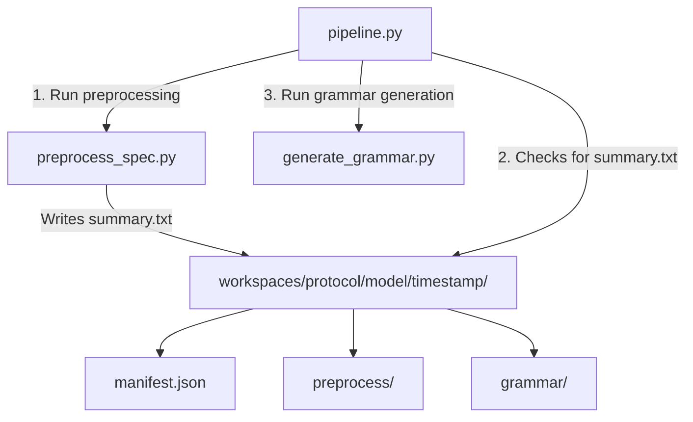

# Protocol Grammar Extraction Pipeline

The extraction process consists of two primary steps: spec preprocessing and grammar generation. To isolate the execution of these steps, avoid file collisions, and easily test/track runs independently, this project implements a **Protocol Workspace** pattern managed by a centralized pipeline orchestrator (`pipeline.py`).

Both underlying tasks (`preprocess_spec.py` and `generate_grammar.py`) remain fully independent and can still be run standalone. The orchestrator calls them as subprocesses and pipes all inputs, outputs, logs, and metrics into isolated, versioned workspace directories.

---

## Workspace Directory Structure

Every time you run the pipeline or initialize a workspace for a specific protocol and model combination, a self-contained directory is created under `workspaces/`.

```
workspaces/
└── <protocol>/
    └── <model_key>/
        └── <timestamp>_YYYYMMDD_HHMMSS/
            ├── manifest.json         # Tracks execution status, paths, exit codes, and timestamps
            ├── pipeline.log          # Combined orchestrator logs
            ├── preprocess/           # Output directory for the preprocessing step
            │   ├── info.json         # Extracted protocol metadata (port, transport, type...)
            │   ├── summary.txt       # Filtered spec summary
            │   ├── report.json       # Preprocessing usage metrics & runtime stats
            │   └── extraction.log    # Inner logging for preprocess_spec.py
            └── grammar/              # Output directory for the grammar generation step
                ├── output.spicy      # Generated Spicy grammar
                ├── metrics.json      # Grammar usage metrics & refinement stats
                ├── runtime.log       # Inner logging for generate_grammar.py
                └── debug/            # Auto-generated compilation/refinement attempt logs
                    ├── attempt_01/
                    └── ...
```

### The Manifest File (`manifest.json`)
The workspace state is tracked in a manifest file, serving as a lock/state file. This allows step recovery and resumes:
```json
{
  "protocol": "dns",
  "model": "gemini-3.1-flash",
  "created_at": "2026-05-22T15:05:51.601985+00:00",
  "workspace_dir": "workspaces/dns/gemini-3.1-flash/20260522_170551",
  "steps": {
    "preprocess": {
      "status": "success",
      "started_at": "2026-05-22T15:05:51...",
      "finished_at": "2026-05-22T15:06:12...",
      "exit_code": 0,
      "outputs": {
        "info": "preprocess/info.json",
        "summary": "preprocess/summary.txt",
        "report": "preprocess/report.json"
      }
    },
    "grammar": {
      "status": "pending"
    }
  }
}
```

---

## CLI Usage

The pipeline orchestrator can be invoked via `python3 pipeline.py` with three core commands: `init`, `run`, and `status`.

### 1. Initialize a Workspace
Scaffold the directory structure and create the initial `manifest.json` without executing any LLM queries.
```bash
python3 pipeline.py init <protocol> -m <model_key>

# Example:
python3 pipeline.py init dns -m gemini-3.1-flash
```

### 2. Run the Pipeline
Run both steps in sequence, or execute a single step inside an isolated workspace.

* **Full Pipeline Run (Default)**
  ```bash
  python3 pipeline.py run <protocol> -m <model_key>
  ```
* **Run a Specific Step Only**
  Use the `--only` flag (`preprocess` or `grammar`):
  ```bash
  python3 pipeline.py run dns -m gemini-3.1-flash --only preprocess
  ```
* **Resume a Previous Run**
  If a step failed, or you only ran preprocessing first, you can resume the latest workspace. It will automatically detect completed steps from the manifest and run only what is pending or failed:
  ```bash
  python3 pipeline.py run dns -m gemini-3.1-flash --resume
  ```
* **Keep Going on Error**
  By default, if the first step (`preprocess`) fails, the pipeline aborts. You can override this:
  ```bash
  python3 pipeline.py run dns -m gemini-3.1-flash --keep-going
  ```
* **Pass Custom Grammar Config**
  ```bash
  python3 pipeline.py run dns -m gemini-3.1-flash --config configs/default.yaml
  ```

### 3. Check Workspace Statuses
View a summary table of all workspaces created on the local machine.
```bash
python3 pipeline.py status

# Filter by protocol or model:
python3 pipeline.py status --protocol dns
python3 pipeline.py status --model gemini-3.1-flash
```

---

## Automatic Integration in the Pipeline
When running the full pipeline or resuming a workspace:
* The `preprocess` step executes first and creates `preprocess/summary.txt`.
* Before running the `grammar` step, the pipeline checks if `preprocess/summary.txt` exists in the workspace.
* If found, the pipeline **automatically** appends `--spec-file <workspace>/preprocess/summary.txt` to the `generate_grammar.py` subprocess command.
* If no preprocessed summary is present, the grammar generator safely falls back to standard index resolution.

---

## Component Separation & Design



1. **Subprocess Isolation**: Because scripts are executed via Python's `subprocess` API, any code-level or package-level conflicts are averted, and individual scripts require zero modifications to accommodate workspace logic.
2. **Path Mapping**: `pipeline.py` maps each script's output file paths (`--info-output`, `--summary-output`, `--output-file`, `--metrics-file`, `--debug-dir`) directly to the active workspace subdirectories (`preprocess/` and `grammar/`).
3. **Log Merging**: Standard outputs and logger instances write into their own isolated logs (`preprocess/extraction.log` and `grammar/runtime.log`), while `pipeline.log` captures the overall orchestration flow.
