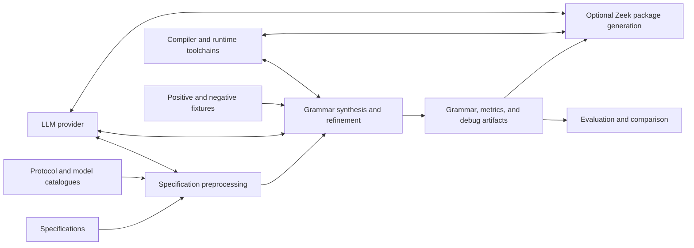
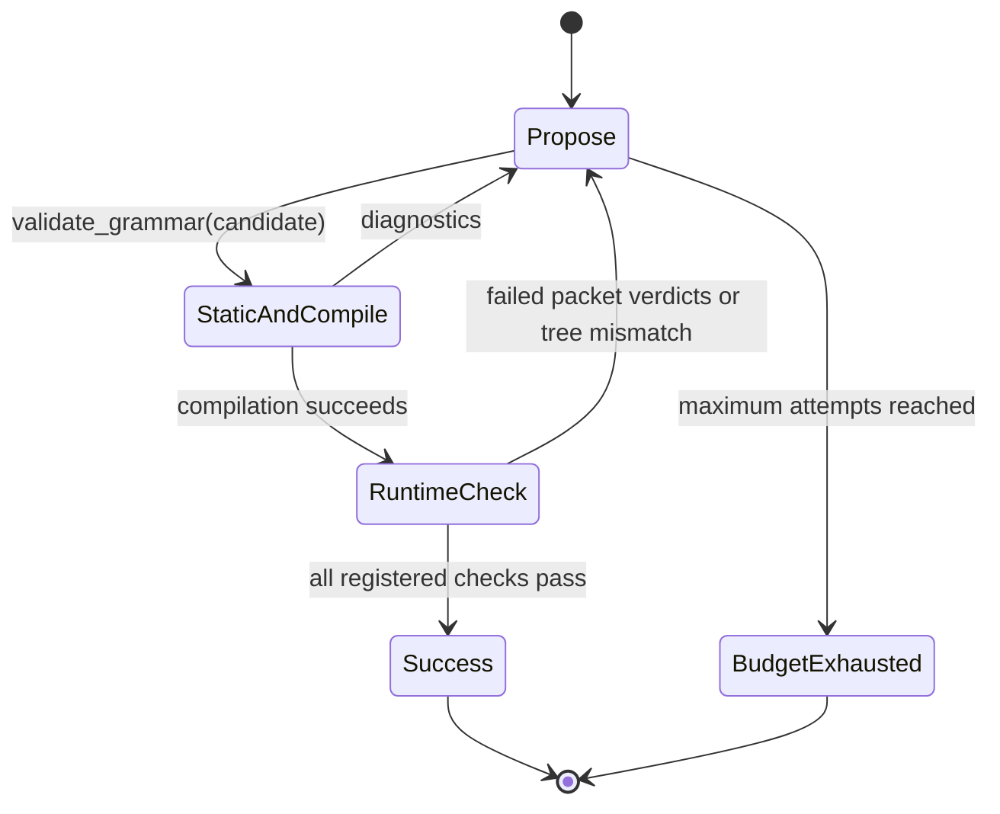
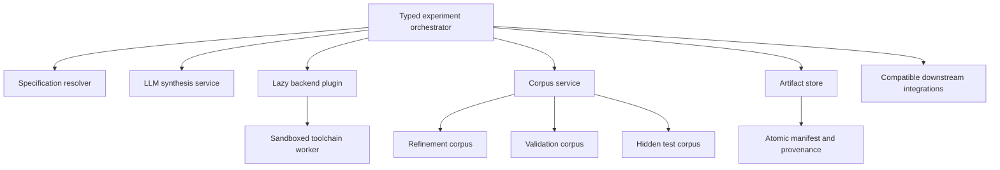

# SpicyGen: Architecture and Technical Design Report

**Implementation snapshot:** 18 August 2026  
**Scope:** `code/grammar-generator/`

## 1. Executive summary

SpicyGen is a framework for synthesizing executable network-protocol grammars from natural-language specifications. Its primary output is a parser in Spicy, 3D/EverParse, or Vest; for Spicy parsers, it can also generate a Zeek analyzer package. The system combines a large language model (LLM), protocol specifications, compiler diagnostics, and packet-based runtime tests in an iterative refinement loop.

The most useful architectural interpretation is not “an LLM that writes parser code,” but **counterexample-guided program synthesis with an LLM as the proposal mechanism**. The model proposes a candidate grammar, while deterministic tools supply increasingly strong oracles:

1. language-specific static heuristics;
2. the target-language compiler;
3. positive and negative packet fixtures;
4. optionally, expected-versus-actual parse-tree comparison.

This separation is the framework's main strength. The model is used where semantic interpretation and code synthesis are valuable, while acceptance remains grounded in executable evidence. Other strong design choices include the target-language registry, the common runtime adapter, data-driven protocol and model catalogues, isolated run workspaces, resumable evaluation, and preservation of refinement artifacts.

The present implementation is best characterized as a research framework rather than a hardened production service. Passing the current validation corpus demonstrates conformance to the available examples, not to the complete protocol specification. Generated code is compiled and, for some backends, executed without fine-grained resource isolation. Some pipeline semantics also need tightening: process completion and grammar validity are represented differently by the generator, evaluator, and workspace manifest; preprocessing generates negative packets but does not automatically install them into the validation corpus; and the nominally multi-language pipeline always includes a Spicy-specific Zeek stage unless explicitly restricted.

## 2. Purpose and design goals

The implementation supports four related research activities:

- synthesizing a protocol grammar from an RFC, local specification, preprocessed summary, or no specification;
- automatically refining that grammar against compiler and runtime feedback;
- comparing models, prompts, configurations, protocols, and target languages under repeatable evaluation runs;
- turning a validated Spicy parser into the skeleton of a deployable Zeek analyzer.

The architecture reflects several implicit goals:

- **backend portability:** the orchestration should not be tied to Spicy alone;
- **model portability:** model selection and provider credentials should not affect domain logic;
- **empirical validation:** a generated grammar should be tested, not merely inspected or trusted;
- **experimental traceability:** source, intermediate candidates, errors, metrics, and outputs should be retained;
- **recoverability:** expensive LLM-based runs should be resumable;
- **research extensibility:** protocols, models, prompts, and evaluation matrices should be mostly data-driven.

These goals are visible in [the target-language registry](../src/target_language.py), [the protocol model](../src/protocol.py), [the refinement loop](../src/agent.py), [workspace management](../src/workspace.py), and [the evaluation runner](../run_eval.py).

## 3. System context

SpicyGen sits between four external systems:

- specification sources, principally RFC text and local standards documents;
- LLM providers exposed through AutoGen/AG2;
- parser toolchains such as `spicyc`, EverParse, Vest, Verus, and a C compiler;
- packet corpora used as executable conformance examples.

Its major outputs are grammar source, validation metrics, debug artifacts, evaluation reports, and optionally a Zeek package.



At the time of this review, the catalogues describe 43 protocols—33 binary and 10 text—and seven model configurations. The checked-in packet corpus contains 448 positive and 317 negative `.bin` fixtures across 41 protocol directories. These numbers describe repository coverage, not independent proof of protocol completeness.

## 4. Architectural structure

The codebase follows a lightweight layered architecture. The layers are conventions rather than enforced package boundaries, but responsibilities are reasonably distinct.

| Layer | Main elements | Responsibility |
|---|---|---|
| Entry points | `generate_grammar.py`, `preprocess_spec.py`, `pipeline.py`, `run_eval.py`, `create_zeek_package.py`, `scripts/run_parser_trace.py` | Parse commands and initiate use cases |
| Application workflows | refinement loop, preprocessing workflow, workspace pipeline, evaluation matrix, Zeek generation | Coordinate multi-step operations |
| Domain model | `Protocol`, `ParserArgument`, `TargetLanguage`, `State`, result dataclasses | Represent protocol contracts, candidates, and outcomes |
| Ports and adapters | provider configuration, `RuntimeAdapter`, compiler callables, RFC retrieval | Isolate external providers and toolchains |
| Research assets | prompts, indices, packet fixtures, expected trees, configurations, stable outputs | Supply policies, examples, and experimental inputs |
| Persistence | workspace manifests, metrics JSON, JSONL reports, debug directories | Record state and provenance on the filesystem |

The dependency direction is mostly inward: command-line programs depend on `src`, while target-specific modules implement callables consumed by common orchestration. A notable exception is [the target-language registry](../src/target_language.py), which imports every concrete backend eagerly; this makes nominally optional backends part of the import-time dependency graph.

## 5. End-to-end processing pipeline

### 5.1 Protocol and model resolution

`protocol_index.json` is the authoritative protocol catalogue. A protocol entry identifies its human-readable name, text or binary character, specification source, and optional external parser arguments. [Protocol loading](../src/protocol.py) converts this JSON into typed Python objects.

`model_index.json` maps stable experiment-facing model keys to provider-specific model names, context-window metadata, and optional prices. [Provider configuration](../src/providers.py) translates this record and the selected YAML LLM parameters into an AutoGen configuration.

This design deliberately separates stable experiment identifiers from vendor API identifiers. It improves reproducibility when reports refer to a key such as `gpt-5.4`, although reproducibility still depends on the provider keeping the referenced model behavior stable.

### 5.2 Specification acquisition and preprocessing

A protocol specification is loaded from a local file when configured; otherwise RFC-backed entries are retrieved and cleaned. Grammar generation can override this source with `--spec-file` or replace it with a no-spec hypothesis prompt.

[Specification preprocessing](../preprocess_spec.py) performs three independent LLM-assisted tasks:

- extracting structured protocol metadata;
- selecting relevant specification intervals without paraphrasing them;
- generating close-to-valid negative packets in JSONL form.

The summarizer uses a tool call rather than free-form summarization. The model selects exact start and end markers, and [the extraction module](../src/tools/extraction.py) resolves them against whitespace-normalized source text, merges overlapping intervals, and copies the original text. This is an important provenance-preserving decision: it reduces context size without introducing a second LLM-written interpretation between the standard and the grammar generator.

The negative-packet path is only partially integrated. Preprocessing writes `negative-packets.jsonl`, while runtime validation reads `.bin` files from `data/raw/<protocol>/negative/`. [A conversion script](../scripts/write_negative_packets.py) exists, but the main pipeline does not invoke it. Consequently, newly generated negatives do not affect the grammar refinement run in the same workspace unless a separate manual curation/import step occurs.

### 5.3 Prompt construction

[Prompt construction](../src/prompts.py) composes four kinds of policy:

1. a general role and extraction objective;
2. a target- and protocol-type-specific language manual from `prompts/`;
3. an optional external parser argument contract;
4. instructions governing validation tool use and termination.

Separating prompt assets from Python orchestration is a sound research choice. Prompt variants can be reviewed and versioned as experimental inputs, and text and binary protocols can receive different language guidance.

The external argument contract handles protocols whose parsers require managed context not present in packet bytes—for example, a configured frame length. The protocol catalogue supplies stable names and target-specific types. The prompt requires an exact public entry signature, and the Spicy runtime validates that signature before binding per-packet values from `.bin.args.json` sidecars.

### 5.4 Grammar synthesis and refinement

[The refinement loop](../src/agent.py) instantiates two AutoGen agents:

- a target-language developer backed by the selected LLM;
- a non-human `CompilerProxy` that executes registered validation and RFC-retrieval tools.

The developer receives the specification and produces candidate source. `validate_grammar` applies compilation first and runtime checks only after successful compilation. Diagnostics are returned to the same conversation so the model can revise the candidate.



The loop records each attempt's compilation status, accepted positive count, rejected negative count, and whether the source changed. After runtime validation, a simple score gives one point to each correct packet verdict. The highest-scoring candidate is retained; equal scores retain the earlier candidate. If no candidate reaches runtime validation, the last compiled-or-uncompiled response is returned.

This “best observed candidate” policy is valuable for research because a failed run can still yield a useful partial parser. It also requires consumers to check the `success` metric rather than assume the emitted file is valid.

### 5.5 Compilation and semantic validation

[The generic compiler helper](../src/tools/compiler.py) accepts a target-specific compilation callable. Each concrete backend can run inexpensive static checks before invoking its real compiler. For example, the Spicy frontend detects reserved field identifiers and bitfields missing explicit bit order, producing more actionable feedback than a downstream failure might provide.

[The runtime layer](../src/tools/runtime.py) defines a common protocol around three concepts:

- `RuntimeArtifact`: a prepared parser and optional cleanup callback;
- `ParseResult`: the result of applying it to one packet;
- `RuntimeAdapter`: functions for preparation, execution, optional packet-specific preparation, caching, and result summarization.

The shared runtime algorithm discovers positive and negative fixtures, prepares a parser once where possible, executes all fixtures, compares expected and actual acceptance, collects failures, and cleans temporary artifacts. Concrete adapters encapsulate important backend differences:

- **Spicy** compiles to an `.hlto` artifact and runs `spicy-dump`;
- **3D** invokes EverParse, generates C wrappers, compiles them with GCC, and runs the resulting executable;
- **Vest** generates Rust, invokes Verus for verification and compilation, and runs the resulting executable.

For Spicy, positive fixtures may also have expected `.tree` files. A structural mismatch is treated as a failed positive verdict. This closes a major loophole in acceptance-only testing: a trivial `bytes &eod` grammar may accept valid packets while extracting no useful structure.

External parser arguments introduce packet-specific compilation. SpicyGen validates the generated entry signature, type-checks sidecar values, generates a wrapper that binds arguments by name in declared order, and caches compiled wrappers for packets with identical context. This is a well-contained solution to the mismatch between parser configuration and raw packet fixtures.

### 5.6 Workspace orchestration

[The pipeline](../pipeline.py) runs preprocessing, grammar generation, and Zeek packaging as subprocesses inside an isolated timestamped workspace managed by [workspace helpers](../src/workspace.py).

```text
workspaces/<protocol>/<model>/<timestamp>/
├── manifest.json
├── pipeline.log
├── preprocess/
│   ├── info.json
│   ├── summary.txt
│   ├── negative-packets.jsonl
│   ├── report.json
│   └── extraction.log
├── grammar/
│   ├── output.<language>
│   ├── metrics.json
│   └── debug/
└── zeek-package/
```

Subprocess isolation keeps the standalone programs independently usable and prevents their argument parsing, logging configuration, and process-level failures from being entangled. The manifest acts as a small persistent state machine with `pending`, `running`, `success`, and `failed` states. Resume mode skips successful steps and retries the remainder.

The workspace is effectively a **unit of work** and a provenance bundle. It makes each experiment inspectable and avoids output collisions, but the manifest is not a transaction log: writes are not atomic, no lock prevents concurrent updates, and a process killed while a step is `running` leaves that status behind until resumed.

### 5.7 Evaluation

[The evaluation runner](../run_eval.py) expands a YAML configuration into the cross-product of protocols, models, generation configurations, target languages, and repeated samples. It executes runs in parallel, persists per-run state, aggregates JSON metrics, calculates success statistics and pass@k, and produces a Markdown summary.

The evaluator correctly distinguishes three outcomes:

- the process completed and the grammar passed validation;
- the process completed but the grammar did not pass validation;
- the generation process itself failed or did not produce trustworthy metrics.

It also removes stale metrics before retrying, preventing an interrupted or malformed rerun from inheriting an earlier success. This is a subtle but important reproducibility safeguard.

### 5.8 Zeek integration

[Zeek package creation](../create_zeek_package.py) parses the generated Spicy module and entry unit, derives a stable analyzer name, scaffolds a package with `zkg`, adapts the parser for Zeek, and asks an LLM to generate `.evt`, Zeek-facing Spicy, and Zeek script files. A bounded refinement loop feeds `spicyz` diagnostics back to the model. It then generates protocol-detection signatures, builds tests, and optionally installs the package.

This stage repeats the successful pattern used for grammar synthesis: probabilistic generation is bounded by deterministic compilation feedback. It is intentionally Spicy-specific and should be treated as an optional downstream integration, not as a generic target-language stage.

## 6. Design patterns

### 6.1 Strategy and adapter

`TargetLanguage` groups the behavior that varies by backend: prompt selection, extension, response cleaning, compilation, and runtime. `RuntimeAdapter` normalizes different preparation and execution models. Together they implement Strategy and Adapter patterns without a deep inheritance tree.

This composition-first approach is appropriate because backend differences are procedural and toolchain-oriented. Adding a backend generally means implementing small functions and registering a descriptor rather than subclassing a large framework class.

### 6.2 Registry

The target-language map and the JSON protocol/model indices are registries. They centralize selection and make supported variants discoverable to command-line argument parsers. The tradeoff is that the Python registry currently imports concrete backends eagerly, reducing isolation between optional toolchains.

### 6.3 Proxy agent and tool-mediated control

The AutoGen `CompilerProxy` represents the environment to the LLM. It exposes a narrow capability surface instead of general shell access. This is both a Proxy pattern and a capability-security boundary: the model can validate a submitted grammar and optionally retrieve an RFC, but it is not directly given arbitrary process execution.

### 6.4 Feedback controller / counterexample-guided synthesis

The core generate–validate–diagnose–revise cycle resembles counterexample-guided inductive synthesis. Compiler messages and failing packets are counterexamples to the current candidate. Unlike classical synthesis, the proposal function is an LLM and completeness is not guaranteed, but the architectural analogy is useful because it emphasizes the role of oracles, budgets, scoring, and termination.

### 6.5 Functional core with an imperative shell

Many transformations are pure or nearly pure: prompt construction, metric construction, interval resolution, parse-tree comparison, argument rendering, matrix expansion, and summary generation. Entry points and adapters handle filesystem, network, and subprocess effects. The boundary is not formal, but it makes important logic unit-testable.

### 6.6 Sidecar metadata

`.info`, `.tree`, and `.args.json` files attach human explanations, structural expectations, and external context to immutable packet bytes. Sidecars avoid inventing a container format and keep fixtures easy to inspect. Their weakness is referential integrity: renaming a packet or omitting its sidecar is detected only at use time.

### 6.7 Artifact-oriented workflow

Workspaces, per-attempt source files, compiler logs, runtime logs, metrics, and evaluation summaries form an artifact-oriented architecture. The filesystem is both persistence layer and interoperability boundary. This is simple and research-friendly, although it lacks schema migration, atomic multi-file commits, and database-level queries.

## 7. Important design decisions and tradeoffs

### Deterministic validation surrounds probabilistic generation

The LLM is not trusted to judge its own output. This improves reliability and makes failures actionable. The limitation is oracle quality: the system can only detect properties represented by static checks, compilers, and fixtures.

### Compilation precedes runtime testing

Fail-fast compilation avoids expensive parser preparation for syntactically invalid candidates and gives the model precise errors. It also means candidates that never compile receive no semantic score; the returned fallback may simply be the last response.

### Positive and negative fixtures have equal weight

The best-candidate score is the count of correct verdicts. This is transparent and easy to interpret, but a large positive set can dominate a small negative set, or vice versa. A weighted or normalized score could better reflect the relative importance of over-acceptance and under-acceptance.

### Exact interval extraction instead of abstractive summarization

The preprocessing agent identifies spans and the program copies source text. This preserves normative wording and reduces hallucination. Marker resolution can still fail when the model selects ambiguous or inaccurate boundaries, and coverage statistics measure quantity rather than semantic completeness.

### Subprocess composition instead of in-process orchestration

The workspace pipeline reuses standalone CLIs unchanged, isolates failures, and produces command-level logs. The costs are repeated startup/import work, stringly typed passthrough arguments, duplicated validation, and weaker static contracts between stages.

### Data-driven catalogues

New protocols and models can usually be added without modifying workflow code. However, JSON schema is enforced informally during loading. Malformed or incomplete records may fail late, and catalogue evolution has no declared version.

### Best-effort output on unsuccessful synthesis

Returning the best observed candidate preserves research value. It is safe only when downstream systems consistently honor the `success` field. The filename alone does not certify validity.

### Backend-specific prompts

Language manuals encode toolchain knowledge separately from the generic agent loop. This improves backend quality and prompt experimentation, but behavior now depends on large untyped text assets whose changes should be treated like code changes in evaluation.

## 8. Correctness model

SpicyGen currently provides **bounded empirical assurance**, not formal proof of full protocol conformance.

A successful grammar generation run establishes that, within the configured attempt budget:

- the target-specific heuristic checks passed;
- the selected compiler accepted the source;
- all enabled positive fixtures were accepted;
- all enabled negative fixtures were rejected;
- when enabled and available, Spicy parse trees matched expected structural trees.

It does not establish that:

- all valid protocol messages are accepted;
- all invalid messages are rejected;
- stateful multi-message behavior is correct unless represented by the runtime harness;
- security properties such as bounded memory, bounded time, or resistance to adversarial inputs hold;
- the grammar faithfully represents specification sections not exercised by fixtures;
- generated Zeek event semantics are complete.

There is also a current edge-case inconsistency: if a protocol directory exists but contains no registered packet verdicts, the validator tells the agent to terminate after successful compilation, yet `state.success` is not set. The emitted metrics therefore report failure. This should be resolved by defining whether compile-only validation is a success, a separate “unverified” status, or an error.

The strongest defensible result label is therefore “passes the configured SpicyGen validation suite,” accompanied by corpus counts, configuration, target/toolchain versions, and the exact grammar artifact.

## 9. Reproducibility and observability

The framework records a useful set of experimental signals:

- model, protocol, target language, and specification source;
- elapsed time and token/cost usage when exposed by the provider;
- attempt-by-attempt compilation and packet scores;
- first successful compilation and best iteration;
- termination reason and retrieved RFCs;
- refinement source, compiler output, runtime output, and build artifacts when debugging is enabled;
- workspace and evaluation state for resume.

The evaluation layer adds copied configuration, run identifiers, process stdout/stderr, aggregate JSONL, Markdown summaries, model/protocol aggregates, and pass@k.

For thesis-grade repeatability, the following provenance is still desirable:

- the Git commit and dirty-worktree status;
- exact prompt hashes or copied prompt files;
- model-provider response identifiers and model revision where available;
- compiler/runtime versions and container image digest;
- packet corpus hash and per-fixture manifest;
- random seed and all effective configuration after defaults and overrides;
- specification source URI, retrieval date, and content hash.

Without these, two runs with the same visible model key and YAML can still differ because of provider-side model updates, prompt changes, RFC retrieval changes, toolchain upgrades, or fixture edits.

## 10. Extensibility analysis

### Adding a protocol

The intended extension path is data-driven: add a protocol catalogue entry, supply or identify a specification, and create positive/negative fixtures with optional sidecars. This is a low-friction interface. In practice, fixture design is the dominant engineering task because it defines the semantic oracle.

### Adding a model

A model record is sufficient when its provider family is already supported. A new provider requires another branch in `get_autogen_config`. This is a small Factory function today; if providers proliferate, provider adapters with credential validation and capability metadata would scale better.

### Adding a target language

The current extension contract requires:

- prompts for each supported protocol type;
- a response cleaner;
- a compiler function returning `CompileResult`;
- a `RuntimeAdapter`;
- a `TargetLanguage` registry entry;
- wrapper/build logic when the runtime requires it;
- tests and environment documentation.

The contract is conceptually clean, but it is distributed across files and conventions. A backend conformance test suite and a small plugin registration API would reduce omission risk.

### Adding a downstream integration

Zeek packaging is currently embedded as a named pipeline step and assumes Spicy. Future integrations would benefit from a separate integration registry keyed by compatible source language, rather than adding more language-specific branches to the main pipeline.

## 11. Testing strategy

The test suite covers pure helpers and important integration seams: protocol loading, configuration/provider construction, interval extraction, Spicy preprocessing, parse-tree comparison, runtime adapters, external argument binding and wrapper caching, workspace lifecycle, evaluation outcome semantics, parser tracing, and Zeek package generation/refinement.

This is a good distribution for a system with expensive and environment-sensitive dependencies: most tests replace compilers, providers, or subprocesses at a narrow boundary. Checked-in stable grammar outputs and packet corpora also provide valuable material for regression tests.

The main testing gaps are end-to-end contract tests across the full pipeline, standardized conformance tests for every registered backend, failure-injection tests for interrupted manifest writes, timeout/resource-limit tests, and mutation or coverage analysis of packet oracles. A small hermetic sample protocol with fake LLM and fake toolchains would permit a complete pipeline test without credentials.

## 12. Risks and technical debt

The following issues are ordered by their impact on the validity and safe operation of experiments.

### 12.1 Untrusted generated code execution

3D and Vest backends compile generated source into native executables and run them; Spicy also executes generated parser logic through its runtime. Most compiler and packet subprocesses have no individual timeout, memory limit, or process sandbox. The outer evaluation runner has a one-hour timeout, but standalone generation and the workspace pipeline do not provide the same containment.

**Recommendation:** run compilation and parsing in backend-specific containers with read-only inputs, no network, CPU/memory/process limits, per-command timeouts, and disposable output directories. Treat this as a correctness feature as well as a security feature because hangs otherwise bias or stall evaluations.

### 12.2 Divergent meanings of success

`generate_grammar.py` exits with code zero even when no grammar passes; validity is recorded in `metrics.json`. The evaluator handles this distinction correctly. The workspace pipeline, however, marks the grammar step `success` solely from the process return code. Thus the manifest can say the grammar stage succeeded while its metrics say the grammar is invalid.

**Recommendation:** represent execution status and validation outcome separately—for example, `status: completed` plus `validation: passed|failed|unverified`. Apply the same vocabulary across generator, workspace, evaluator, and package stage.

### 12.3 Generated negatives are disconnected from validation

The preprocessing stage spends model calls generating negative packets, but the refinement stage reads only the repository corpus. Automatically trusting LLM-generated negatives would itself be unsafe, because a malformed “negative” may actually be valid.

**Recommendation:** add an explicit curation gate: JSONL generation → schema validation → materialization into a workspace candidate corpus → human or reference-parser review → promotion into the authoritative fixture corpus. Record provenance for each fixture.

### 12.4 Pipeline/backend compatibility is implicit

The default pipeline contains the Zeek package stage for all target languages. `_run_zeek_package` looks for the default `.spicy` grammar path, so a full 3D or Vest run is structurally incompatible unless the user limits stages. Vest is registered as a target, but parser-trace auto-detection omits `.vest`; the evaluator maintains a separate extension map and relies on its generic fallback. These independent capability lists can drift from the target registry.

**Recommendation:** give pipeline stages declared input/output artifact types and compatibility predicates. Build the plan dynamically—for example, `spec → grammar[3d]` ends after validation, while `spec → grammar[spicy] → zeek-package` is allowed.

### 12.5 Eager backend imports weaken optionality

The target registry imports all backend modules when loaded. Vest modules read required environment variables at import time, so a missing Vest configuration can prevent use of unrelated Spicy functionality.

**Recommendation:** lazily load backend descriptors or move environment resolution into backend invocation. Report unavailable backends with actionable diagnostics while leaving installed backends usable.

### 12.6 Corpus overfitting and leakage

The same packet fixtures guide refinement and determine success. The agent may specialize to observed examples, especially when packet bytes and detailed errors are shown. There is no independent holdout set in the generation loop.

**Recommendation:** separate train/refinement, validation, and hidden test corpora. Use the refinement corpus for feedback, select candidates on validation data, and report final results on packets never exposed to the LLM. Cross-implementation differential testing and fuzzing would strengthen the oracle.

### 12.7 Filesystem state is not transactional

Manifest and evaluation state files are overwritten directly. Concurrent writers or a crash during a write can corrupt state. Timestamp resolution is one second, allowing same-protocol/model collisions under sufficiently parallel creation.

**Recommendation:** write to a temporary file followed by atomic replacement, use locks where multiple processes can update shared state, give runs collision-resistant IDs, and define recovery for stale `running` entries.

### 12.8 Zeek package verification is incomplete

The LLM-generated integration files receive a `spicyz` compile check, but subsequent `cmake` and `make` calls do not enforce successful return codes. The parser is also adapted after the generation prompt is constructed, so compile-check inputs and final package inputs may diverge. Optional installation mutates the local Zeek environment.

**Recommendation:** compile exactly the final staged package, use checked subprocesses, run package tests before installation, make installation opt-in at the orchestration boundary, and record build/test/install outcomes separately.

### 12.9 Input schemas and parsing are permissive

Protocol/model JSON and YAML configuration lack explicit schemas. Some LLM-response validators log missing fields but continue to index them, which can convert a validation warning into a later exception. Spicy module/entry parsing uses regular expressions and comma splitting, which may be brittle for more complex syntax.

**Recommendation:** introduce JSON Schema or typed validation at all external-data boundaries; fail once with aggregated diagnostics. Prefer a real syntax parser or compiler-generated metadata for source introspection where available.

### 12.10 Configuration and dependency surface

The package lists several overlapping AutoGen-family dependencies, and provider behavior is partly encoded in conditionals. Effective configuration is assembled at runtime but not persisted as a single resolved object.

**Recommendation:** minimize and pin the orchestration dependency set, validate credentials/capabilities before a costly run, and store the fully resolved redacted configuration in each workspace.

## 13. Recommended architectural evolution

A pragmatic roadmap is:

1. **Unify outcome semantics.** Introduce typed run results with separate execution, compilation, semantic-validation, and integration statuses.
2. **Harden execution.** Add containerized toolchain workers, timeouts, resource limits, and checked subprocess calls.
3. **Make artifacts explicit.** Give every pipeline stage typed inputs, outputs, content hashes, and compatibility rules.
4. **Separate refinement and evaluation corpora.** Add holdout fixtures and provenance-aware corpus manifests.
5. **Make backends lazy plugins.** Register capabilities without importing unavailable toolchains and provide backend conformance tests.
6. **Close the negative-packet loop.** Add a reviewed promotion workflow rather than silently mixing generated fixtures into the oracle.
7. **Strengthen reproducibility.** Snapshot prompts, effective configs, source/toolchain versions, and corpus hashes in workspaces.
8. **Harden state persistence.** Use atomic writes, collision-resistant run IDs, locks, and stale-run recovery.
9. **Generalize integrations.** Move Zeek into a Spicy-compatible downstream integration layer and keep language generation independent.
10. **Expand semantic oracles.** Add stateful trace tests, differential testing, fuzzing, coverage feedback, and protocol-specific invariants.

An evolved architecture could preserve the existing research-friendly CLIs while introducing an internal typed orchestration API:



## 14. Overall assessment

SpicyGen has a strong research architecture because it treats LLM output as a candidate to be tested rather than an answer to be trusted. The compiler/runtime adapter split, prompt specialization, external parser argument contract, packet-sidecar design, workspace isolation, and resumable evaluation runner are coherent and mutually reinforcing.

Its next stage of maturity is less about adding more prompting logic and more about strengthening the experimental boundary: precise outcome semantics, independent test corpora, sandboxed execution, complete provenance, atomic state, and explicit compatibility between pipeline stages. These changes would make the framework's results easier to reproduce, compare, and defend, while preserving the flexible synthesis loop that is its defining contribution.

## Appendix A. Key implementation map

| Concern | Primary implementation |
|---|---|
| Grammar-generation CLI | [`generate_grammar.py`](../generate_grammar.py) |
| Refinement loop and candidate scoring | [`src/agent.py`](../src/agent.py) |
| Prompt policies and composition | [`src/prompts.py`](../src/prompts.py), [`prompts/`](../prompts/) |
| Protocol and parser-argument model | [`src/protocol.py`](../src/protocol.py), [`protocol_index.json`](../protocol_index.json) |
| Model/provider mapping | [`src/providers.py`](../src/providers.py), [`model_index.json`](../model_index.json) |
| Target-language registry | [`src/target_language.py`](../src/target_language.py) |
| Generic compiler/runtime contracts | [`src/tools/compiler.py`](../src/tools/compiler.py), [`src/tools/runtime.py`](../src/tools/runtime.py) |
| Concrete backends | [`src/tools/spicy/`](../src/tools/spicy/), [`src/tools/_3d/`](../src/tools/_3d/), [`src/tools/vest/`](../src/tools/vest/) |
| Specification preprocessing | [`preprocess_spec.py`](../preprocess_spec.py), [`src/tools/extraction.py`](../src/tools/extraction.py) |
| Workspace state and pipeline | [`src/workspace.py`](../src/workspace.py), [`pipeline.py`](../pipeline.py) |
| Evaluation matrix and reports | [`run_eval.py`](../run_eval.py), [`evals/`](../evals/) |
| Standalone parser tracing | [`run_parser_trace.py`](../scripts/run_parser_trace.py) |
| Zeek integration | [`create_zeek_package.py`](../create_zeek_package.py), [`prompts/zeek/`](../prompts/zeek/) |
| Packet corpus | [`data/raw/`](../data/raw/) |
| Tests | [`tests/`](../tests/) |

## Appendix B. Suggested result vocabulary

To remove ambiguity across tools, each run can expose orthogonal fields:

| Field | Example values | Meaning |
|---|---|---|
| `execution_status` | `pending`, `running`, `completed`, `failed`, `timed_out` | Whether the workflow itself ran |
| `compile_status` | `not_attempted`, `failed`, `passed` | Whether a candidate compiled |
| `validation_status` | `unverified`, `failed`, `passed` | Whether the configured semantic suite passed |
| `artifact_status` | `missing`, `partial`, `candidate`, `validated` | How downstream consumers may treat the output |
| `integration_status` | `not_applicable`, `not_run`, `failed`, `passed` | Whether an optional integration was verified |

This model preserves useful partial outputs while preventing a zero process exit code, a completed experiment, and a validated grammar from being conflated.
